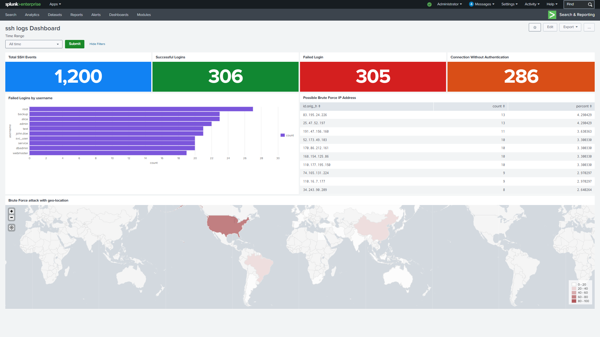
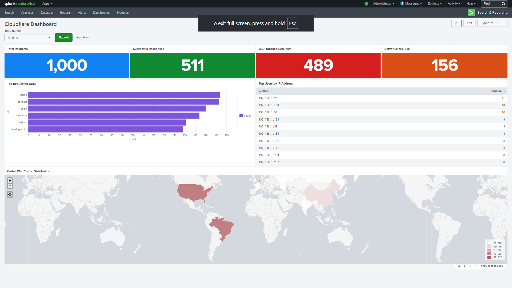

# SOC Threat Detection and Log Analysis with Splunk

A hands-on Security Operations Center (SOC) lab using Splunk Enterprise to investigate authentication activity, monitor web requests, and explore security events in structured JSON logs.

## Project goals

- Identify repeated failed SSH logins and suspicious source IP activity.
- Explore SSH authentication events and geographic enrichment with Splunk's `iplocation`.
- Monitor Apache request volume, HTTP status codes, requested URIs, and client IPs.
- Analyse custom-generated Cloudflare-style JSON events, including blocked actions and traffic patterns.
- Build dashboards that summarise findings for an analyst.

## Data sources

| Source | Repository location | Purpose |
|---|---|---|
| SSH authentication events | `logs/ssh_logs_sample (1).json` | Failed and successful login analysis |
| Apache sample events | `logs/apache_logs_sample (1).json` | Web traffic and HTTP status analysis |
| Cloudflare-style events | `logs/cloudflare_logs.json` | Request, action, status, and client-IP analysis |
| SPL examples | `queries/queries.txt` | Search queries for the three dashboard use cases |
| Dashboard screenshots | `screenshots/` | Visual evidence of the dashboards |

The Cloudflare-style logs are custom-generated demonstration data, not a claim of access to a live Cloudflare account. Results depend on the fields and events in the supplied sample data.

## Repository structure

```text
.
├── README.md
├── logs/
│   ├── apache_logs_sample (1).json
│   ├── cloudflare_logs.json
│   └── ssh_logs_sample (1).json
├── queries/
│   └── queries.txt
└── screenshots/
    ├──  apache_dashboard.png
    ├── Cloudflare_dashboard.png
    └── ssh_dashboard.png
```

## Tools

- Splunk Enterprise
- Splunk Search Processing Language (SPL)
- JSON event data
- Python-generated demonstration logs
- Splunk GeoIP enrichment with `iplocation`

## Getting started

1. Install and start Splunk Enterprise in a local lab.
2. Create or select the `main` index, or update the queries to match your chosen index.
3. Upload the sample JSON files using **Settings → Add Data → Upload**.
4. Configure source, host, and sourcetype values consistently with the SPL searches. The examples in `queries/queries.txt` use specific source/host names; adjust them if your imported data uses different names.
5. Open **Search & Reporting**, run the relevant searches, and use the results to build dashboard panels.
6. Compare your panels with the screenshots in `screenshots/`.

Splunk's exact upload options and field extraction can vary by version. Confirm that JSON fields are extracted correctly before relying on query output.

## Use case 1 — SSH authentication monitoring

The SPL examples cover total SSH events, failed logins, successful logins, connection events, commonly targeted usernames, source IPs, and geographic distribution.

Example — count repeated failed logins by source IP and username:

```spl
index=main sourcetype=_json event_type="Failed SSH Login"
| stats count AS failed_attempts by src_ip user
| where failed_attempts > 5
| sort - failed_attempts
```

This is an illustrative pattern. Ensure field names match the imported SSH events; the repository also includes dataset-specific field names in `queries/queries.txt`.

## Use case 2 — Apache web traffic

Explore total request volume, successful responses, client/server errors, popular URIs, request counts by IP, and geographic distribution.

Example — requests over time:

```spl
index=main source="apache_logs.json" host="webserver" sourcetype=_json
| timechart count
```

## Use case 3 — Cloudflare-style event analysis

The sample dataset supports searches for total requests, HTTP status distributions, blocked actions, popular URIs, top client IPs, and geographic enrichment. Confirm field names and capitalisation such as `Status`, `Action`, `URI`, and `ClientIP` against ingested events.

## Dashboard screenshots

### SSH monitoring



### Apache web monitoring


### Cloudflare-style traffic analysis



## What this project demonstrates

- Translating security questions into SPL searches
- Investigating authentication and web-traffic events
- Grouping events by user, IP address, URI, status, and time
- Enriching IP data with geographic fields
- Communicating findings through dashboards

## Scope and limitations

This is a lab-based monitoring project using sample and generated logs. It does not represent a production SOC deployment. Real-time alerting, response automation, threat-intelligence integration, and production data pipelines are future improvements unless separately configured.

## Future improvements

- Add reproducible data-ingestion instructions for each sample file
- Validate and standardise field names across sources
- Export dashboard definitions where supported
- Add scheduled alerts and documented detection thresholds
- Add tests or expected-result notes for important SPL searches

## Author

**Pravinash SMR** — Cybersecurity, SIEM, and threat-detection projects.
